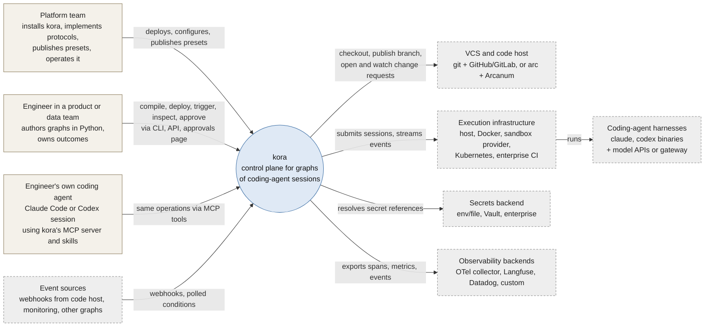
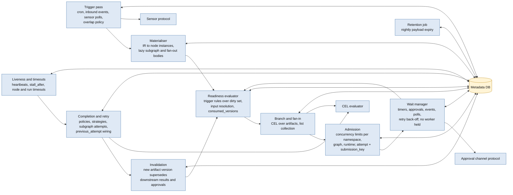
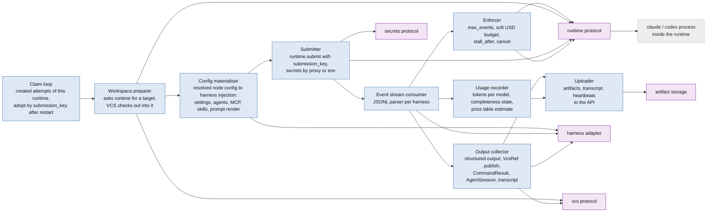
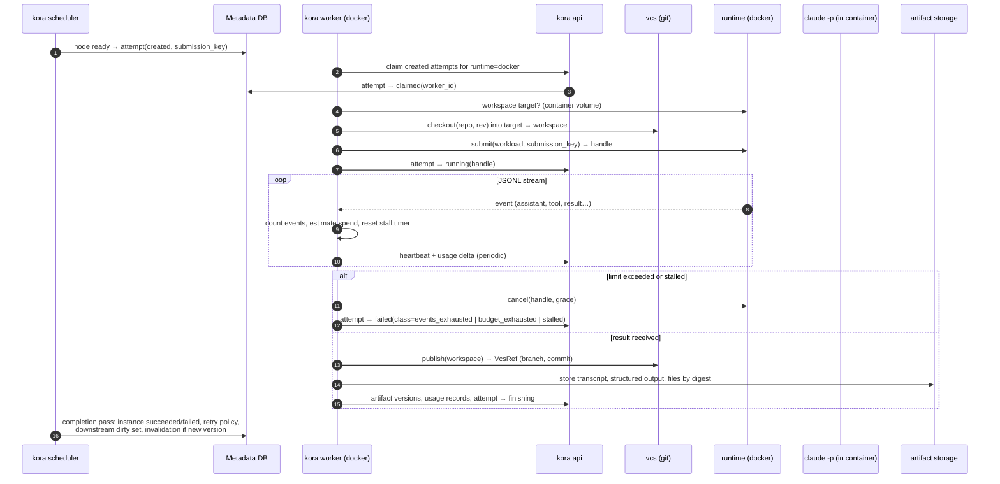
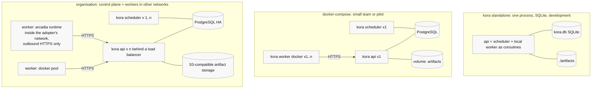

# kora MVP architecture: components, boundaries and stack

Status: stack decided by the owner on 2026-10-15; diagrams for review. This document is the map; the other files in `docs/design/` are the territory: [ir.md](ir.md) (what a graph is), [data-model.md](data-model.md) (what the control plane stores), [scheduler.md](scheduler.md) (who decides what and when), [protocols.md](protocols.md) (where adopters plug in), [api-and-agent-surface.md](api-and-agent-surface.md) (how humans and their agents operate it), [dsl.md](dsl.md) (how graphs are written). Diagrams follow the C4 levels (context, containers, components) in Mermaid so they render on GitHub.

## 1. System context (C4 level 1)

Agent sessions inside a graph never call kora. They receive typed inputs through the workspace and the prompt and leave typed outputs for the worker to collect (FR-0.0).

## 2. Containers (C4 level 2)

```mermaid
flowchart TB
    classDef proc fill:#dfe9f5,stroke:#3b6ea5,color:#111
    classDef store fill:#fff4d6,stroke:#b8860b,color:#111
    classDef client fill:#e8f5e9,stroke:#2e7d32,color:#111
    classDef plugin fill:#f3e5f5,stroke:#7b1fa2,color:#111
    classDef ext fill:#eeeeee,stroke:#888,color:#222,stroke-dasharray: 4 3

    subgraph clients [Clients of the API, thin by principle]
        CLI[kora CLI]:::client
        MCP[kora mcp<br/>stdio process per user session]:::client
        SKILLS[Harness skills<br/>teach the user's agent the API]:::client
        WEB[kora web<br/>React SPA: approvals in MVP,<br/>runs, graphs, attempts, cost later;<br/>static files served by kora api]:::client
    end

    subgraph cp [Control plane]
        API[kora api<br/>HTTP API /api/v1, OpenAPI,<br/>webhook endpoints, MCP over HTTP,<br/>serves kora web static files, auth]:::proc
        SCHED[kora scheduler<br/>stateless passes: triggers, readiness,<br/>admission, waits, timeouts, completion,<br/>invalidation, retention]:::proc
        DB[(Metadata DB<br/>PostgreSQL; SQLite in standalone)]:::store
        ART[(Artifact storage<br/>payloads and transcripts by digest;<br/>local FS in MVP, S3 later)]:::store
    end

    subgraph workers [Workers, one per runtime name, outbound-only]
        W1[kora worker --runtime local]:::proc
        W2[kora worker --runtime docker]:::proc
        W3[kora worker --runtime arcadia<br/>adopter's, inside their network]:::proc
    end

    subgraph plugins [Protocol implementations, loaded by entry points]
        P_RT[runtime]:::plugin
        P_HA[harness adapter<br/>claude, codex]:::plugin
        P_VCS[vcs<br/>git; arc by adopter]:::plugin
        P_APR[approval channel<br/>cli/api, vcs change request]:::plugin
        P_SEC[secrets]:::plugin
        P_AST[artifact storage]:::plugin
        P_ATY[artifact type]:::plugin
        P_OBS[observability exporter]:::plugin
        P_AUTH[authentication]:::plugin
        P_SEN[sensor]:::plugin
    end

    HARN[claude / codex binaries<br/>fixed per installation]:::ext
    EXT_VCS[Code host]:::ext
    EXT_OBS[Observability backends]:::ext
    EXT_SRC[Webhook sources]:::ext

    CLI -->|HTTPS, bearer token| API
    MCP -->|HTTPS, user's token| API
    SKILLS -.->|used by the user's agent through| MCP
    WEB -->|HTTPS, user's token, generated TS client| API
    EXT_SRC -->|HMAC or bearer| API

    API <-->|SQL| DB
    SCHED <-->|SQL, row claims| DB
    API -->|read payloads, serve downloads| ART

    W1 & W2 & W3 -->|claim attempts, stream events,<br/>upload artifacts: HTTPS to the API| API
    W1 & W2 -.->|optional direct SQL when co-located| DB

    W1 & W2 & W3 --> P_RT & P_HA & P_VCS & P_SEC & P_AST
    P_HA --> HARN
    P_VCS --> EXT_VCS
    SCHED --> P_SEN & P_APR
    API --> P_AUTH & P_APR & P_ATY
    API & SCHED & W1 & W2 & W3 --> P_OBS --> EXT_OBS
```

Responsibilities, in one line each:

| container | owns | never does |
|---|---|---|
| `kora api` | the only implementation of every operation; authentication; webhook ingestion to `inbound_event`; OpenAPI from which the CLI, the MCP tools and the web client are generated; serving the `kora web` static build; MCP over HTTP | scheduling decisions; running sessions; UI logic |
| `kora web` | the production frontend: approvals in MVP, then runs, graphs, attempts, artifacts and cost views; a thin client of the API through a TypeScript client generated from OpenAPI | logic of its own; direct database access |
| `kora scheduler` | the passes in scheduler.md section 2; approval request creation with aggregated cost; invalidation; retention | calling runtimes or harnesses |
| `kora worker` | claiming `created` attempts of its runtime; workspace checkout through the VCS protocol into a runtime-named target; submission with `submission_key`; consuming the harness JSONL stream; enforcing `max_events`, soft budget and `stall_after`; collecting outputs into artifact versions; usage records | deciding what runs next |
| Metadata DB | every entity in data-model.md; the only run state; row claims with `SELECT … FOR UPDATE SKIP LOCKED` on Postgres | payload bytes |
| Artifact storage | payload bytes by digest, transcripts | metadata |
| `kora mcp` | stdio MCP server for the user's own harness; tools generated from OpenAPI; forwards with the user's token | any logic of its own |
| `kora standalone` | api, scheduler and a local worker as coroutines in one process on SQLite | production use |

Workers talk to the API, not to the database (decided, section 7): an adopter's worker inside a closed network then needs one outbound HTTPS route and no database credentials, which is the Arcadia/Sandbox placement the acceptance test requires. Co-located workers may use direct SQL as an optimisation.

## 3. Components inside the scheduler (C4 level 3)

Every box is a pure function of database rows to database rows inside one short transaction; nothing is held in memory between passes, so a second scheduler replica is only a throughput change (NFR-1.2, scheduler.md section 8).

## 4. Components inside a worker (C4 level 3)

## 5. One attempt, end to end

## 6. Deployment shapes

The three shapes run the same code; only process layout, database driver and artifact storage implementation change (NFR-0.1, NFR-7.1).

## 7. Stack per component

Rows marked *decided* were settled by the owner on 2026-10-15 or follow from earlier decisions; rows marked *proposed* are defaults the owner has not objected to and can change without affecting the architecture.

| component | stack | status | alternatives considered |
|---|---|---|---|
| Language and runtime | Python 3.11+ (NFR-11.1), `asyncio` throughout | decided | — |
| Packaging | monorepo: one distribution `kora` with extras (`kora[postgres]`, `kora[docker]`, `kora[otel]`); `uv` for dependency management and `hatchling` as build backend; `src/` layout; the frontend lives in `web/` (pnpm) and its production build is embedded into the Python package at build time, so one `pip install` and one image carry everything | decided | Poetry; multi-package workspace; separate frontend repository |
| IR models and JSON Schema | Pydantic v2 models as the single definition; `model_json_schema()` publishes `ir.schema.json`; YAML read/write with `ruamel.yaml` (keeps comments for lock-file style output) | decided (Pydantic), proposed (ruamel) | PyYAML (no round-trip) |
| Expression language | CEL via `cel-python` (DD-3) | decided | — |
| Prompt templates | Jinja2 `SandboxedEnvironment` (DD-11) | decided | — |
| HTTP API | FastAPI + Pydantic v2; OpenAPI as the generation source for the CLI, the MCP tools and the web TypeScript client; NDJSON streaming for logs and events; `uvicorn` | decided | Litestar; Django REST |
| Metadata DB access | SQLAlchemy 2.0 (Core + typed ORM) with `asyncpg` for PostgreSQL and `aiosqlite` for SQLite; Alembic migrations (`kora db upgrade`) | decided | raw SQL with `psycopg` 3; SQLModel |
| Row claims and scheduler loop | PostgreSQL `SELECT … FOR UPDATE SKIP LOCKED` inside short transactions; SQLite: single-writer process with the same statements minus `SKIP LOCKED` | decided (scheduler.md §3, §10) | advisory locks; external queue (Redis) rejected: run state must live only in the DB (NFR-1.2) |
| Worker ↔ control plane | workers call the HTTP API (claim, heartbeat, usage, artifact upload, state transitions) over outbound HTTPS; direct SQL only as an opt-in for co-located workers | decided | workers write SQL directly |
| CLI | Typer (Click-based) with a generated API client from OpenAPI (`openapi-python-client` or hand-written `httpx` client); `rich` for tables | proposed | Click directly; argparse |
| MCP server | official `mcp` Python SDK (FastMCP); tool list generated from OpenAPI at build time; stdio process `kora mcp` and the same tools mounted on the API under `/mcp` (DD-18) | proposed | hand-written MCP tools (parity drift risk) |
| Harness adapters | `asyncio.subprocess` running `claude --bare -p … --output-format stream-json` and `codex exec --json`; JSONL parsers per harness with versioned event schemas; no Agent SDK dependency; harness binaries fixed per installation image (DD-14) | decided | Claude Agent SDK for Claude |
| Local runtime | subprocess on the worker host with a per-attempt temp workspace | decided | — |
| Docker runtime | Docker Engine API through `aiodocker` (async) or `docker` SDK; one container per attempt, workspace as a volume, egress rules via container network config; credential proxy as a sidecar when enabled | proposed | shelling out to the `docker` CLI (simpler, harder to test) |
| VCS (git) | `git` CLI via subprocess for clone/worktree/push; code-host APIs via `httpx` (GitHub, GitLab) for change requests and status | proposed | dulwich/pygit2 (no benefit over the CLI for MVP) |
| Artifact storage | local filesystem by digest in MVP; S3-compatible via `aiobotocore` post-MVP | decided (local), proposed (S3 client) | MinIO-only client |
| Secrets | env and file providers in MVP; Vault via `hvac` post-MVP | decided | — |
| Frontend (`kora web`) | React + TypeScript + Vite; TanStack Query for data; shadcn/ui (Tailwind) components; React Flow for graph views later; TypeScript API client generated from OpenAPI; static SPA served by `kora api`; token login kept in a cookie (DD-19). MVP ships the approvals views; runs, graphs, attempts and cost views follow | decided | server-rendered Jinja2 + HTMX; Next.js; SvelteKit |
| Observability | OpenTelemetry Python SDK with OTLP exporter as the reference exporter; `prometheus-client` for scheduler and worker metrics; `structlog` JSON logs | proposed | vendor SDKs only (Langfuse, Datadog) without OTel |
| Authentication | static bearer token in MVP; authentication protocol with an OIDC implementation via `authlib` post-MVP | decided | — |
| Testing | `pytest` + `pytest-asyncio`; `hypothesis` for IR and compiler properties; `testcontainers` for PostgreSQL; fake harness and fake runtime shipped as test fixtures (NFR-10.1); conformance suites as pytest plugins adopters run against their implementations | proposed | — |
| Repo layout | `src/kora/{ir,dsl,api,scheduler,worker,protocols,plugins/{runtime,harness,vcs,…},cli,mcp}`; `web/` (Vite project, build output embedded into `src/kora/api/static` at package build); `docs/`; `examples/`; `tests/`; `conformance/` | decided | multi-package monorepo |

## 8. Boundaries that the stack must not blur

- The API is the only writer of operations; CLI, MCP and the web frontend never contain logic (FR-0.3). Generating their schemas from OpenAPI is how parity is enforced mechanically.
- The scheduler never imports user Python; it reads IR rows (FR-1.2).
- Workers never decide; they execute one attempt and report (DD-13).
- Protocol implementations are loaded by entry points and never imported by name from core modules (NFR-5.2).
- Nothing in standalone mode may exist only there (NFR-0.1).
